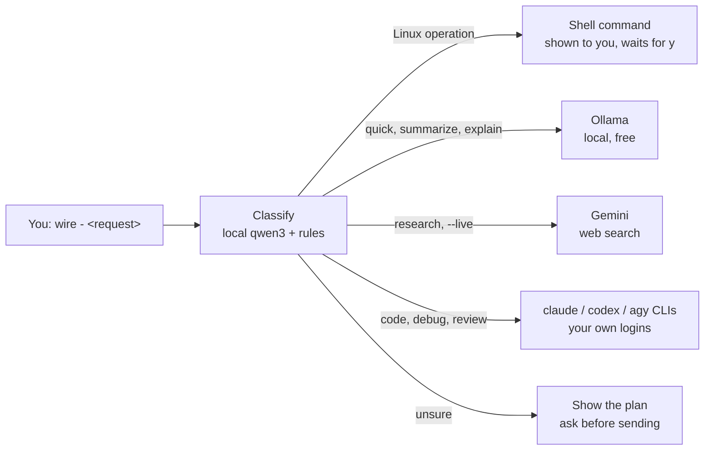

# TheWire

**Type what you want in plain English. Wire decides which AI should do it, runs it on your machine, and asks you before anything consequential happens.**

```bash
wire - show me what's eating my disk          # becomes a shell command, shown to you first
wire - summarize my standup notes             # goes to a small local model, free
wire - explain how X25519 key exchange works  # goes to a larger local model
wire ask "refactor the router" --to claude    # you pick the AI yourself
```

Wire is a local-first command-line dispatcher. It sends each request to the right worker: local models through [Ollama](https://ollama.com), the `claude`, `codex` and `agy` command-line tools you have already installed and signed into, Gemini for live web search, or your own shell. Everything runs on your computer, under your accounts and your keys.

> **License and disclaimer: read before using.**
> Free for personal, noncommercial use under the [PolyForm Noncommercial License 1.0.0](LICENSE.md). No business, resale or commercial use is granted.
> The software is provided **as is, with no warranty of any kind**, and the authors are not liable for any damage arising from its use (see [LICENSE.md](LICENSE.md), "No Liability").
> You are responsible for your own use, any costs charged by AI providers you connect, and following their terms of service.
> See the [FAQ](FAQ.md) for plain-English answers.

---

## Contents

- [What's in 1.1.0](#whats-in-110)
- [How it works](#how-it-works)
- [Install](#install)
- [Everyday use](#everyday-use)
- [Use Wire from Claude Code and Codex (MCP)](#use-wire-from-claude-code-and-codex-mcp)
- [Command reference](#command-reference)
- [Configuration](#configuration)
- [Safety and privacy](#safety-and-privacy)
- [Updating](#updating)
- [What's next: Wire 2.0](#whats-next-wire-20)
- [Project layout](#project-layout)
- [License, FAQ, contributing](#license-faq-contributing)

---

## What's in 1.1.0

| Area | What you get |
|---|---|
| **Plain-English dispatch** | `wire - <anything>`: a local classifier works out what kind of task it is and picks a worker. Clear requests run straight away, uncertain ones show you the plan first, and unclear ones are refused with a suggestion. |
| **Workers** | Ollama (local, free), `claude`, `codex` and `agy` CLIs (your own logins), Gemini (live web search, your own key), Groq (free tier, your own key), and your shell. Wire skips any worker you haven't set up. |
| **Shell with a human in the loop** | Requests that read as Linux operations become one shell command. It is shown to you exactly as it will run, and waits for `y`. There is no auto-run and no bypass. |
| **Project awareness** | `wire work <project> "<task>"` sends the task together with that project's context; `project-status`, `project-brief`, `diagnose`. |
| **Memory and documents** | Local memory store and a document store with embeddings (`ingest`, `rag search`, `memory search`). Everything stays in local SQLite. |
| **Background dispatch** | An optional daemon that processes queued tasks, with fallback between workers, cooldowns, and a quality check (PhaseGate) that sends weak results to you for review. |
| **Scheduling** | `wire cron`: recurring tasks with standard 5-field schedules. |
| **MCP server** | 9 tools that let Claude Code or Codex use Wire directly. |
| **Model management** | List, assign, pull and upgrade Ollama models per task type (`wire models`, `modelupdate`). |
| **Self-update** | `wire version` checks for a newer release; `wire update` moves to it after asking you. |

New in 1.1.0: working yes/no prompts everywhere, `--help` that never runs a command, an explicit `--to` that never stops to ask, and a round of security fixes. See the [CHANGELOG](CHANGELOG.md).

---

## How it works



- **Confidence gates.** At 85% or more, Wire dispatches straight away. At 60–84% it shows the plan and asks, unless you named the worker with `--to`, which counts as your confirmation. Below 60% it stops and suggests the exact `wire task` command.
- **Local first.** Wire tries free local models before paid ones. Live search asks for your consent before switching to Gemini's paid tier when the free quota runs out. Requests sent to `claude`, `codex` or `agy` count against your own plans with those providers.
- **No hidden processes.** Wire runs the vendor CLIs as ordinary local programs. Each one keeps its own credentials, and Wire never passes one vendor's key to another.

---

## Install

**You need**

- Linux or WSL2, and [Bun](https://bun.sh) 1.1 or newer
- [Ollama](https://ollama.com), recommended (most of the free routing uses it):
  ```bash
  ollama pull qwen3:1.7b        # quick tasks, summaries
  ollama pull qwen3:4b          # classification, explanations
  ollama pull qwen2.5-coder:14b # code review
  ollama pull nomic-embed-text  # memory and document search
  ```
- Optional: the `claude`, `codex` or `agy` CLIs, installed and signed into **your own** accounts. Skip any you don't use.

**Steps**

```bash
git clone https://github.com/wantanswers100/TheWire
cd TheWire
bun install

# Put `wire` on your PATH (the launcher finds the repo through the link)
mkdir -p ~/.local/bin && ln -sf "$PWD/bin/wire" ~/.local/bin/wire

# Folder Wire uses for messages and projects
mkdir -p ~/projects/inbox

# Optional: your own API keys (only for the workers you want)
cp .env.example .env    # then edit .env

# Check what Wire can see
wire setup
```

`wire setup` lists which workers it found. A missing worker is fine, because Wire routes around it.

---

## Everyday use

```bash
wire - what is my public IP                  # shell, asks before running
wire - research WebAssembly GC proposals --live   # live web search
wire ask "review src/router/index.ts" --to codex  # choose the worker
wire ask "plan the migration" --dry-run      # see the plan, send nothing
wire shell "df -h"                           # an exact command, with approval
wire work my-app "why did the tests slow down"    # project-aware
wire memory search "gateway auth"            # your local memory
wire status                                  # what is running, what is healthy
```

---

## Use Wire from Claude Code and Codex (MCP)

Wire includes an MCP server. MCP is the standard way AI coding tools connect to external tools.

**Claude Code**

```bash
claude mcp add wire -- wire mcp
```

**Codex** (`~/.codex/config.toml`)

```toml
[mcp_servers.wire]
command = "wire"
args = ["mcp"]
```

| Tool | What it does |
|---|---|
| `wire_ask` | Plain-English dispatch, optional `to` |
| `wire_work` | Project-aware dispatch |
| `wire_diagnose` | Project health review |
| `wire_memory_search` | Search Wire's memory |
| `project_list` / `project_context` / `project_search` / `project_diff` | Read your registered projects |
| `project_write` | Write inside a project's `outputs/`, `context/` (and similar) folders only, never through links that lead outside |

The MCP server never prompts. Anything that needs your approval (shell commands, paid fallbacks) is refused over MCP and has to be run from a terminal.

---

## Command reference

| Group | Commands |
|---|---|
| Plain English | `wire - <task>`, `wire ask "<task>"` with `--to <agent>` `--dry-run` `--confirm` `--live` `--cost free-first` |
| Shell | `wire shell "<cmd>"` |
| Projects | `work`, `project-status`, `project-brief`, `prep-online`, `diagnose`, `workspace add/list/remove`, `inbox` |
| Code | `code-review <file>`, `explain-file <file>` |
| Web | `weather [place]`, `fetch "<url>" "<question>"` |
| Background | `dispatch start/stop/status`, `dispatch review list/approve/reject`, `eval`, `agent status`, `task`, `cron add/list/del/run/next` |
| Memory | `memory search/list`, `ingest <file>`, `rag search` |
| Models | `models`, `models loaded/set/pull/info`, `modelupdate`, `providers`, `providers check/upgrade` |
| Platform | `setup`, `status`, `internet`, `version`, `update`, `engaged`, `mcp`, `classify`, `route`, `policy` |
| Protocol | `keygen`, `send`, `recv`, `verify`, `inspect` |
| Help | `wire --help`, `wire <command> --help`, `wire help terms [word]` |

`--help` or `-h` always prints help and never runs the command.

---

## Configuration

| Where | What |
|---|---|
| `.env` (from `.env.example`) | Your own API keys (all optional) and per-skill model overrides (`OLLAMA_*`, `GEMINI_*`) |
| `.wire-state/local.json` | Settings for your installation only: `approver` (the name a Codex EXECUTE handoff must carry, default `owner`) and `briefingPath` (an optional daily briefing shown by `wire-start`) |
| `.wire-state/project-entities.json` | Optional: your project names, so document search can recognise them, e.g. `[{"dir":"my-app","patterns":["\\bmy[-\\s]?app\\b"]}]` |
| `WIRE_CLAUDE_MODEL` | Model for the `claude` worker (default `sonnet`) |

`.env`, `.keys/` and `.wire-state/` are git-ignored and never leave your machine.

---

## Safety and privacy

| Guarantee | How |
|---|---|
| Nothing runs on your shell without you | Every command is shown first, with hidden control characters made visible, and waits for `y`. Without a terminal, it refuses. A blocklist stops catastrophic commands even if approved. |
| Wire holds no credentials of its own | You supply your own keys and CLI logins. Each vendor CLI receives only its own vendor's key. |
| Writes stay inside the project | `project_write` resolves the real path, refuses symbolic links and only writes to allowed folders. |
| Local only | The optional gateway binds to `127.0.0.1`. Secrets and Wire's state are never added to the document store. |
| No telemetry | Wire only goes online for what you ask: requests to the providers you chose, `fetch`, `weather`, live search, and the release check in `wire version`. |

Full details: [SECURITY.md](SECURITY.md). To report a vulnerability, use GitHub's private vulnerability reporting on this repository, not a public issue.

---

## Updating

```bash
wire version   # what you run, and whether a newer release exists
wire update    # move to the newest release (asks first, fast-forward only)
```

Releases are tagged `vX.Y.Z`. **If you cloned TheWire before 1.1.0**, clone it again once: the public history was replaced with clean release snapshots, so an older clone can't fast-forward.

---

## What's next: Wire 2.0

Wire 2.0 is a simpler, safer design that is planned but not shipped yet:

- **You switch it on and off.** `wire on` and `wire off`; nothing runs while it's off.
- **Only the CLI tools you already use.** Claude, Codex, agy and Ollama, plus any you add yourself. Wire never holds API keys, and the HTTP gateway is removed.
- **`wire doctor`** checks every connected tool, and a status line always shows which Wire is active.
- **Rules you edit yourself.** `/wire …` inside Claude Code and agy, `$wire …` in Codex, or `wire config` in a terminal. AI tools can propose changes; only you approve them.
- **A secure, always-present log of every configuration change.**

Features may change before release.

---

## Project layout

```
bin/          wire launcher (symlink it onto your PATH)
src/cli/      commands
src/router/   classification, routing rules, fallback and cooldown policy
src/dispatch/ workers (Ollama, Claude, Codex, agy, Gemini, Groq, shell) and the background loop
src/agents/   shell approval, memory, documents, live search
src/mcp/      MCP server
src/gateway/  optional local HTTP gateway (127.0.0.1)
src/envelope/ src/schema/  WireProtocol v1 message format (Zod)
tests/        bun test suites
docs/architecture/  architecture, protocol and gateway references
```

Built with TypeScript on Bun. The only runtime dependency is [Zod](https://zod.dev).

```bash
bun test              # full test suite
bunx tsc --noEmit     # type check
```

---

## License, FAQ, contributing

- [LICENSE.md](LICENSE.md): PolyForm Noncommercial 1.0.0
- [FAQ.md](FAQ.md): what you can and can't do, in plain English
- [SECURITY.md](SECURITY.md): threat model and reporting
- [CONTRIBUTING.md](CONTRIBUTING.md): this is a personal project shared publicly. Issues are welcome, but reviews and fixes aren't guaranteed.
- [CHANGELOG.md](CHANGELOG.md): what changed in each release
